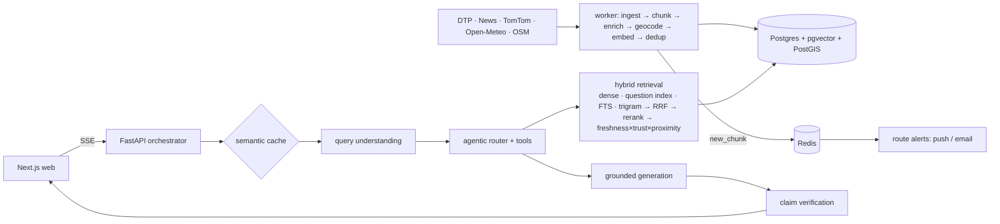

# Delhi Traffic Copilot

A citizen-facing assistant that answers questions about Delhi traffic (diversions, closures,
incidents, why a road is slow, when to travel) in **English, हिन्दी and Hinglish**. It runs an
advanced RAG pipeline over official Delhi Traffic Police advisories, news, live TomTom traffic
and Open-Meteo weather. Answers stream with numbered citations, map highlights and live cards,
then get checked claim by claim. When the evidence is weak, it says so.

> **Not an official service.** Always follow on-ground instructions and official Delhi Traffic
> Police channels (traffic.delhipolice.gov.in · helpline 1095 · @dtptraffic).



## Features

- **Chat + map**: streamed answers with hoverable `[n]` citations, a "verified" badge, revisions
  after fact-checking, follow-up chips, live speed/weather/incident cards, map highlights with
  auto-fit, and an EN/हिं toggle.
- **RAG internals drawer** on every answer: cache, query understanding (mini-map of resolved
  places, IST window, rewrites), tools with latency, per-list ranks → RRF → rerank → final score
  factors, dropped candidates, context size, per-claim verification, latency and token cost.
- **Advisories feed** with filters, validity windows, mini-maps and Hindi/English versions.
- **My Routes**: save a commute and get push, email or in-app alerts when a new advisory or
  incident hits your corridor, or when congestion builds before you leave. Optional morning digest.
- **Admin**: source health, ingestion volume, TomTom budget gauge, p50/p95 latency, cache hit
  rate, eval scorecards, worst answers with feedback, and an eval-question review queue.
- **Works without API keys**: heuristic understanding/enrichment, extractive cited answers,
  hashing embeddings and lexical rerank. Each missing key disables one feature, with a UI notice.

## Quick start (local)

```bash
cp .env.example .env            # add GROQ_API_KEY (and GEMINI_API_KEY, TOMTOM_API_KEY) for the full experience
docker compose up -d --build    # db, redis, api (:8000), worker, web (:3000)
make seed                       # gazetteer, segments, events, weather, recent DTP advisories + news (a few minutes)
open http://localhost:3000
```

On slow networks set `APT_MIRROR` / `PIP_INDEX_URL` in `.env`. Backend installs are hash-pinned
(`backend/requirements.lock`), so any mirror is safe. Postgres and Redis are exposed on host
ports **5433 / 6380** (configurable) to avoid clashing with local services.

<details>
<summary>Native development (without Docker for api/web)</summary>

```bash
docker compose up -d db redis
cd backend && uv venv && uv pip install -e ".[dev]"   # add ".[local-ml]" for bge-m3 / bge-reranker
alembic upgrade head && uvicorn app.main:app --reload
python -m app.worker                                  # in another shell
cd ../frontend && npm ci && npm run dev
```
</details>

## Stack

FastAPI · SQLAlchemy 2 (async) · Alembic · Postgres 16 + pgvector (HNSW) + PostGIS + pg_trgm ·
Redis · APScheduler · LiteLLM (default **Groq** `openai/gpt-oss-120b` for answers,
`llama-3.1-8b-instant` for fast tasks, **Gemini Flash** fallback; per-model RPM limiter, circuit
breaker, JSON-schema retries) · bge-m3 / bge-reranker-v2-m3 (optional) · Tesseract `hin+eng` ·
trafilatura · Langfuse · Prometheus · Next.js 14 · Tailwind · MapLibre GL · Radix UI.

## CLI

```bash
python -m app.cli db seed [--backfill-limit 400]
python -m app.cli ingest backfill-dtp [--max-id N] | backfill-news --days 180 | gazetteer | run-once <dtp|news|rss|tomtom|weather|expire|retention>
python -m app.cli eval run --subset smoke|full [--gate] [--ablation all] [--update-baseline]
python -m app.cli eval generate-questions | export | import
python -m app.cli alerts simulate --lat 28.6129 --lon 77.2295
```

## Quality

- **Tests**: 100+ backend unit tests, integration tests against real Postgres/Redis (pipeline, hybrid
  retrieval, answer flow, abstention, SSE API, route alerts, scripted-LLM path) and frontend
  Vitest tests. CI also runs ruff, mypy (strict), ESLint, Prettier and Docker builds.
- **Evaluation**: 153 questions over a frozen corpus in an isolated DB, ablations and a CI
  regression gate. See [docs/evaluation.md](docs/evaluation.md).

## Docs

- [docs/architecture.md](docs/architecture.md): services, request flow, data model, failure behaviour
- [docs/rag-design.md](docs/rag-design.md): every RAG technique, why it exists, and how to inspect it
- [docs/evaluation.md](docs/evaluation.md): dataset, metrics, results, ablations
- [docs/deployment.md](docs/deployment.md): Railway / Render / Fly.io + Vercel + Neon / Supabase
- [docs/builder-prompt.md](docs/builder-prompt.md): the original specification

## Data sources & attribution

Delhi Traffic Police (official advisories, always linked) · Google News RSS and publisher
feeds (full text only where robots.txt allows) · TomTom Traffic (© TomTom) · Open-Meteo (CC BY
4.0) · OpenStreetMap contributors (ODbL). The crawler obeys robots.txt, sends a descriptive
User-Agent, waits ≥ 2 s between requests per domain, and caches raw downloads.

## License

MIT
