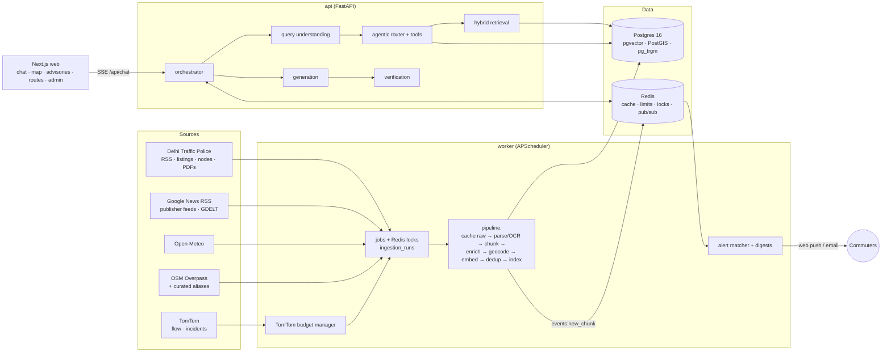

# Architecture

## Services (`docker compose`)

| Service | Image | Role |
|---|---|---|
| `db` | `infra/db` (PostGIS 3.5 + pgvector) | documents, chunks, vectors (HNSW), geometries (GiST), time series (BRIN) |
| `redis` | `redis:7-alpine` | semantic cache, per-IP rate limit, LLM RPM window, job locks, TomTom budget, pub/sub |
| `api` | `backend/Dockerfile` | FastAPI; runs `alembic upgrade head` then uvicorn |
| `worker` | same image | `python -m app.worker`: scheduled ingestion, expiry, retention, alerts, nightly eval |
| `web` | `frontend/Dockerfile` | Next.js standalone server |

## Request flow (`POST /api/chat`)

1. **Semantic cache**: heuristic understanding (no LLM) gives intent, places and a time bucket; the
   normalised query embedding is compared to cached entries in that bucket (cosine ≥ 0.95).
2. **Query understanding**: the fast LLM returns language, intent, place mentions, the time phrase,
   rewrites and sub-questions. Places are geocoded by our gazetteer and the time phrase is resolved
   by the rule engine against the current IST clock, so behaviour is deterministic under a frozen eval clock.
3. **Routing**: the fast LLM picks tools (≤ 4). Per-intent default tools are always added.
4. **Tools** run concurrently with timeouts; `search_advisories` is the hybrid retriever.
5. **Relevance gate**: abstain when the best final score < `RELEVANCE_THRESHOLD` and no tool returned data.
6. **Generation**: the strong LLM streams an answer over numbered evidence (chunks + tool results).
7. **Verification**: per-claim support check; unsupported claims are removed or hedged; > 30 %
   unsupported triggers one strict regeneration; a `revision` event replaces the streamed text.
8. Citations, map features, cards and internals are emitted; the message is persisted.

## Data model (core)

`sources`, `raw_documents`, `documents`, `chunks` (generated `tsv_en`/`tsv_simple`, `geom`,
validity window, dedup cluster), `chunk_embeddings` / `question_embeddings` (vector(1024), HNSW
cosine), `places` (trigram on `search_text`), `chunk_locations`, `segments`, `traffic_flow_obs`,
`traffic_incidents`, `weather_obs`, `events`, `users`, `saved_routes` (corridor geometry),
`push_subscriptions`, `alerts_sent`, `conversations`, `messages`, `feedback`,
`eval_questions` / `eval_runs` / `eval_results`, `ingestion_runs`.

## Failure behaviour

| Missing / failing | Behaviour |
|---|---|
| No LLM key | heuristic query understanding + enrichment, extractive cited answers, lexical verification; UI banner |
| Groq rate limit / error | per-model RPM limiter waits; retries with backoff; circuit breaker → Gemini fallback |
| No TomTom key | live tools return "unavailable", UI notice, map shows advisories + incidents only |
| Redis down | rate limit fails open, cache skipped, in-process LLM limiter |
| Source down | job records `error` in `ingestion_runs`, worker keeps running |
